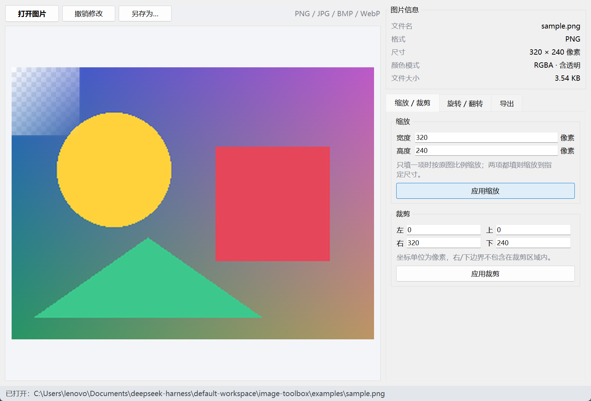

# imgtool 图片工具箱

一个用 Python 编写的**命令行**图片处理工具：查看图片基础信息，并对图片做缩放、裁剪、旋转、翻转、灰度化和格式转换。

所有编辑结果都会保存为新文件，**不会覆盖原图**，并在终端打印实际保存路径。

## 1. 项目介绍

### 1.1 程序能做什么

- 读取图片的基础信息：文件名、格式、宽高、颜色模式、文件大小（保留两位小数）。
- 对图片做简单编辑：
  - 缩放：指定宽高；只给宽或高时按原图比例缩放。
  - 裁剪：指定左、上、右、下坐标；越界时给出明确提示。
  - 旋转：支持 90、180、270 度（逆时针）。
  - 翻转：水平翻转、垂直翻转。
  - 灰度化：彩色图转灰度图。
  - 格式转换：PNG、JPG、BMP、WebP 之间互转。
- 友好的错误提示：文件不存在、文件不是有效图片、参数非法（宽高 ≤ 0、裁剪越界、角度不支持等）都不会让程序崩溃。
- 透明通道处理：带透明通道的 PNG 保存为 JPG/BMP 时，会自动合成到白色背景上，不会报错。

### 1.2 程序形式

提供两种使用方式，功能完全一致：

- **图形界面（推荐日常使用）**：双击 `启动图片工具.vbs` 打开窗口，选图、点按钮即可。
- **命令行程序（CLI）**：通过 `python -m imgtool <子命令>` 使用，适合批量处理和脚本调用。

### 1.3 图形界面



打开方式（任选一种）：

1. 双击项目根目录下的 `启动图片工具.vbs`（推荐，不会闪黑框）。
2. 双击 `启动图片工具.bat`。
3. 在命令行运行：

```bash
.venv\Scripts\pythonw.exe -m imgtool.gui
```

界面说明：

- 左侧是图片预览，透明区域会显示灰白棋盘格。
- 右上角显示文件名、格式、尺寸、颜色模式和文件大小。
- 右侧三个标签页：
  - 「缩放 / 裁剪」：填写宽高或裁剪坐标后点按钮；
  - 「旋转 / 翻转」：一键旋转 90°/180°/270°、水平/垂直翻转、转灰度；
  - 「导出」：选择格式后点「另存为…」。
- 所有操作只修改内存中的图片，点「撤销修改」可随时恢复原图；保存时不会覆盖原图。

## 2. 环境配置

### 2.1 Python 版本

需要 **Python 3.10 或更高版本**（开发与测试使用 Python 3.12.9）。图形界面使用 Python 自带的 Tkinter，不需要额外安装。

### 2.2 安装依赖

推荐使用 [uv](https://docs.astral.sh/uv/) 管理环境：

```bash
uv venv
uv pip install -e .
```

也可以使用 Python 自带的 venv 和 pip：

```bash
python -m venv .venv

# Windows
.venv\Scripts\activate

# macOS / Linux
source .venv/bin/activate

pip install -r requirements.txt
```

> 本机的工作区里已经创建好 `.venv` 并安装了 Pillow，可以直接跳到第 3 节运行。

## 3. 运行方式

先进入项目目录：

```bash
cd image-toolbox
```

然后激活虚拟环境（二选一）：

```bash
# 方式一：激活后使用 python
.venv\Scripts\activate
python -m imgtool --help

# 方式二：不激活，直接用虚拟环境里的解释器
.venv\Scripts\python.exe -m imgtool --help
```

看到下面的帮助信息说明环境正常：

```text
usage: imgtool [-h] [--version] 命令 ...

一个简单的命令行图片工具：查看图片信息，并进行缩放、裁剪、旋转、翻转、灰度化和格式转换。
```

### 3.1 查看图片信息

```bash
python -m imgtool info examples/sample.png
```

输出示例：

```text
文件名：sample.png
图片格式：PNG
宽度 × 高度：320 × 240 像素
颜色模式：RGBA（带透明通道）
文件大小：3.54 KB
```

查看 JPG 图片：

```bash
python -m imgtool info examples/photo.jpg
```

```text
文件名：photo.jpg
图片格式：JPEG
宽度 × 高度：400 × 300 像素
颜色模式：RGB
文件大小：8.43 KB
```

### 3.2 缩放图片

只指定宽度，高度按比例自动计算：

```bash
python -m imgtool resize examples/sample.png --width 160
```

```text
已保存：C:\...\image-toolbox\examples\sample_resized.png
```

只指定高度，宽度按比例自动计算：

```bash
python -m imgtool resize examples/sample.png --height 120
```

同时指定宽高（按指定尺寸缩放，可能改变比例）：

```bash
python -m imgtool resize examples/sample.png --width 200 --height 200 -o examples/output/square.png
```

### 3.3 裁剪图片

裁剪区域用左、上、右、下四个坐标表示，单位是像素：

```bash
python -m imgtool crop examples/sample.png --left 20 --top 20 --right 220 --bottom 180
```

```text
已保存：C:\...\image-toolbox\examples\sample_cropped.png
```

如果区域超出图片范围，程序会提示实际尺寸，不会崩溃：

```bash
python -m imgtool crop examples/sample.png --left 0 --top 0 --right 999 --bottom 999
```

```text
错误：裁剪区域越界：图片尺寸为 320×240，裁剪区域为 left=0, top=0, right=999, bottom=999。
```

### 3.4 旋转图片

支持 90、180、270 度，按逆时针方向旋转：

```bash
python -m imgtool rotate examples/sample.png --angle 90
```

```text
已保存：C:\...\image-toolbox\examples\sample_rotated90.png
```

### 3.5 翻转图片

水平翻转：

```bash
python -m imgtool flip examples/sample.png --direction horizontal
```

垂直翻转：

```bash
python -m imgtool flip examples/sample.png --direction vertical
```

### 3.6 灰度化

```bash
python -m imgtool gray examples/sample.png
```

```text
已保存：C:\...\image-toolbox\examples\sample_gray.png
```

### 3.7 格式转换

把 PNG 转成 JPG：

```bash
python -m imgtool convert examples/sample.png --format jpg
```

```text
提示：原图带透明通道，目标格式不支持透明，已自动合成到白色背景。
已保存：C:\...\image-toolbox\examples\sample_converted.jpg
```

把 JPG 转成 PNG：

```bash
python -m imgtool convert examples/photo.jpg --format png
```

支持的格式：`png`、`jpg`、`jpeg`、`bmp`、`webp`。

### 3.8 指定输出路径

所有编辑命令都支持 `-o/--output`：

```bash
python -m imgtool resize examples/sample.png --width 100 -o examples/output/small.png
```

不指定 `-o` 时，默认输出到原图所在目录，文件名规则如下：

| 操作 | 默认输出文件名 |
| --- | --- |
| 缩放 | `<原名>_resized.<原扩展名>` |
| 裁剪 | `<原名>_cropped.<原扩展名>` |
| 旋转 | `<原名>_rotated<角度>.<原扩展名>` |
| 翻转 | `<原名>_flipped_<方向>.<原扩展名>` |
| 灰度化 | `<原名>_gray.<原扩展名>` |
| 格式转换 | `<原名>_converted.<目标扩展名>` |

如果 `-o` 指向原图，程序会拒绝执行：

```text
错误：输出文件不能与原图相同，请换一个输出路径。
```

### 3.9 查看帮助

```bash
python -m imgtool --help
python -m imgtool resize --help
```

## 4. 参数说明

| 子命令 | 参数 | 说明 |
| --- | --- | --- |
| `info` | `image` | 图片路径 |
| `resize` | `--width` / `--height` | 目标宽/高（像素，必须 > 0，至少给一个） |
| `crop` | `--left --top --right --bottom` | 裁剪区域坐标（必须满足 left < right、top < bottom 且在图片范围内） |
| `rotate` | `--angle` | 旋转角度，只能是 90、180、270 |
| `flip` | `--direction` | `horizontal` 或 `vertical` |
| `gray` | `image` | 图片路径 |
| `convert` | `--format` | `png`、`jpg`、`jpeg`、`bmp`、`webp` |

通用参数：`-o/--output` 指定输出文件；`--version` 查看版本。

退出码：`0` 成功，`2` 用户输入或参数错误（错误信息输出到 stderr）。

## 5. 项目结构

```text
image-toolbox/
├── imgtool/
│   ├── __init__.py       # 版本号
│   ├── __main__.py       # 支持 python -m imgtool
│   ├── cli.py            # 命令行参数解析与功能调度
│   ├── gui.py            # 图形界面
│   ├── errors.py         # 自定义用户错误
│   ├── image_io.py       # 图片加载、保存、透明通道处理、输出路径
│   ├── info.py           # 图片信息读取与格式化
│   └── operations.py     # 缩放、裁剪、旋转、翻转、灰度化
├── assets/
│   ├── app.ico           # 应用图标
│   └── app.png
├── docs/
│   └── gui.png           # 界面截图
├── tests/
│   ├── test_operations.py
│   └── test_cli.py
├── scripts/
│   ├── generate_samples.py
│   └── generate_icon.py
├── examples/
│   ├── sample.png        # 带透明通道的示例图
│   └── photo.jpg
├── 启动图片工具.vbs      # 双击启动图形界面（无黑框）
├── 启动图片工具.bat
├── .gitignore
├── pyproject.toml
├── requirements.txt
└── README.md
```

## 6. 运行测试

```bash
python -m unittest discover -s tests -v
```

测试覆盖：缩放比例、裁剪越界、旋转角度、翻转像素、灰度模式、透明通道保存、错误提示、默认输出路径、拒绝覆盖原图等。

## 7. 实现说明

- 图片读写使用 [Pillow](https://python-pillow.org/)。
- 所有用户可预期的错误统一抛出 `ImageToolError`，由 `cli.main()` 捕获后打印中文提示并返回退出码 2，不输出 traceback。
- 读写分离：`image_io.py` 负责文件与格式，`operations.py` 只负责像素操作，`cli.py` 只负责参数与输出。
- 保存 JPG/BMP 前，如果图片带透明通道，会先合成到白色背景，再转换为 RGB。
- 默认输出文件名带操作后缀，且保存前会检查输出路径是否等于原图，确保不覆盖原图。

## 8. 常见问题

**Q：运行时提示“不是有效的图片文件”？**
A：确认文件确实是图片且没有损坏；扩展名改成 `.jpg` 的文本文件也会被识别为无效图片。

**Q：处理后的 JPG 背景变成白色了？**
A：原图（如 PNG）带透明通道，而 JPG 不支持透明，程序会自动用白色背景填充。

**Q：可以处理中文路径的图片吗？**
A：可以，Pillow 对中文路径支持良好。

**Q：为什么保存的图片在别的目录？**
A：不指定 `-o` 时，结果保存在原图旁边，终端会打印完整的绝对路径。
